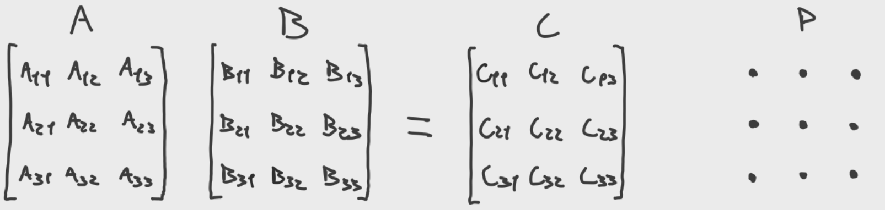
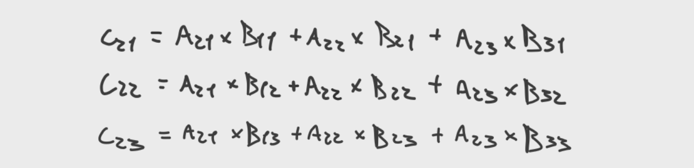
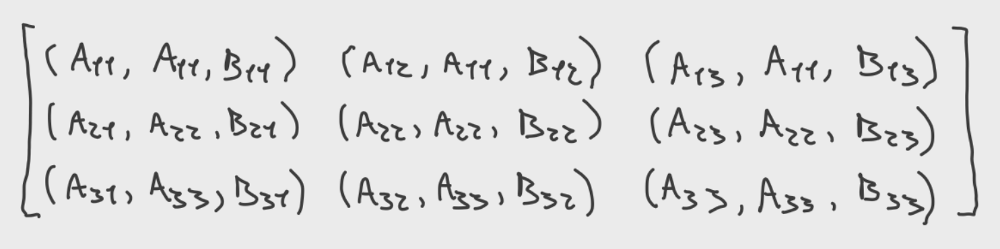
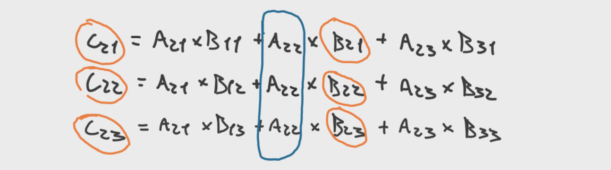
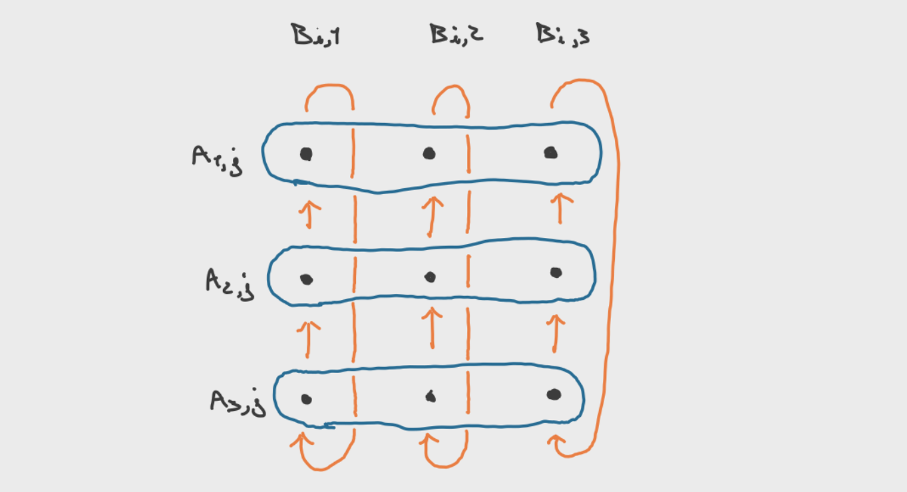
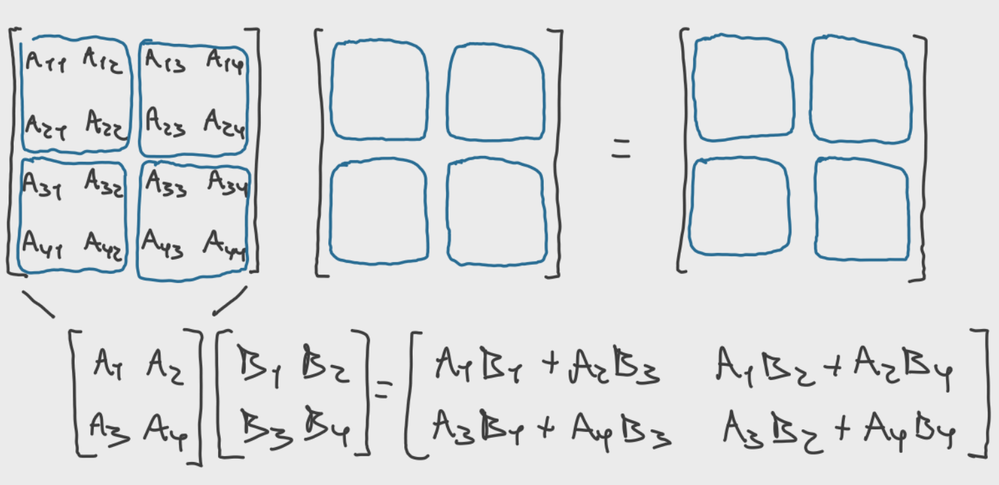
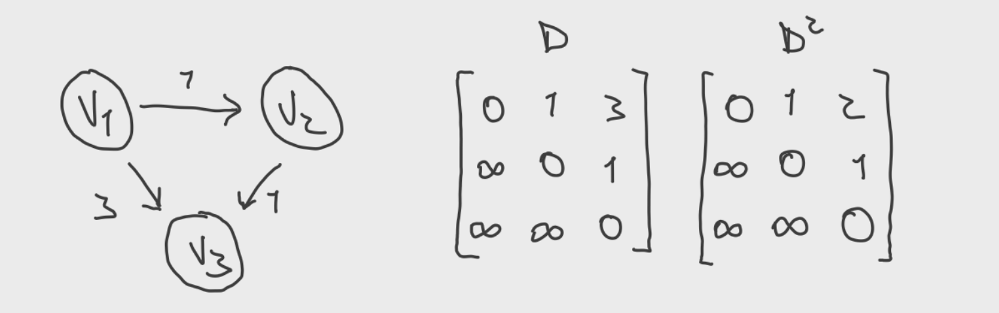

# Fox's Algorithm for Parallel Matrix Multiplication

I've recently had to do some work with Fox's algorithm for parallel matrix multiplication and found that the explanations available online are not very helpful. This is an attempt at a more intuitive (although perhaps less correct) explanation. I hope you enjoy!

> I do not have access, but you might want to read the [original paper](https://www.sciencedirect.com/science/article/abs/pii/0167819187900603).

## Matrix Multiplication

Matrix multiplication is, well, useful. It shows up in a lot of places and we are thus interested in making it fast. We'll focus on square matrices of size $n$. For the multiplication $AB = C$, the naïve algorithm you probably learned in your Linear Algebra classes performs $n$ multiplications for each each cell in the result matrix $C$, and since this matrix has size $n \times n$, the asymptotic complexity of the algorithm is $O(n^3)$.

One way to speed up the calculation is to use a better algorithm. Most notably, the [Strassen algorithm](https://en.wikipedia.org/wiki/Strassen_algorithm) manages to lower this complexity to only about $O(n^{\log_2 7})$. If you like divide-and-conquer algorithms, you might find it entertaining. Later work has discovered even better algorithms _asymptotically_, but those are only useful if the input size is larger than what we would ever need it for (algorithms of this kind are known as galactic algorithms). There is a whole [Wikipedia page](https://en.wikipedia.org/wiki/Computational_complexity_of_matrix_multiplication) on those.

Another, less elegant, way of speeding up the calculation is to throw more computational power onto it by using parallel computation. This is easier said than done, since parallel algorithms need to carefully plan how they are going to organize the different processes, the data they hold and their communication patterns. One such algorithm is Fox's algorithm, which I try to explain here.

## Fox's Algorithm

Fox's algorithm is an algorithm for parallel matrix multiplication which uses a $q \times q$ grid of processes to perform the multiplication of square $q \cdot k \times q \cdot k$ matrices, i.e., square matrices whose size $n$ is divided by $q$.

To understand this algorithm, it is useful to look at a simple example with 9 processes ($q = 3$) and matrices of size $3 \times 3$ ($k = 1$). This situation is depicted in the figure below.

In the multiplication $AB=C$, the value of a given entry in $C$ is the dot product of the corresponding row and column. For instance, $C_{2,3} = A_{2,1} \cdot B_{1,3} + A_{2,2} \cdot B_{2,3} + A_{2,3} \cdot B_{3,3}$. Since addition is a commutative operation, these operations can be done in any order, as long as the elements in the multiplication remain compatible. $C_{2,3} = A_{2,2} \cdot B_{2,3} + A_{2,1} \cdot B_{1,3} + A_{2,3} \cdot B_{3,3}$ is also valid.

The first step of the Fox algorithm is to distribute the values of the matrix among the processes. In this case, the process at position $(2, 3)$ receives both $A_{2,3}$ and $B_{2,3}$. The algorithm will then perform $3$ iterations to compute the contents of $C$. On the first iteration, the process on the $i$-th column of the $i$-th row will broadcast its value $A_{i,i}$ across the row. In our running example, every process on the $j$-th column of the second row holds the value $B_{2,j}$, as shown here: each process has its own value of $A$, the broadcast value of $A$ and its own value of $B$.

If you work out the sums of each entry $C_{2, j}$, each $B_{2,j}$ is multiplied by $A_{2,2}$. Therefore, since in the row broadcast every process got hold of $A_{2,2}$, we can multiply and get one of the components of $C_{2, j}$. The same is valid for other rows.

On the second iteration, the broadcast on row $i$ will originate from the process at column $i + 1$. But now the values known by every process for $A$ and $B$ do not match! The process in position $(2, 3)$ received the value of $A_{2, 3}$, which should be multiplied by the value of $B_{3, 3}$, but the process only has $B_{2, 3}$! In fact, every process needs the value of $B$ that is immediately below it, which lets us conveniently send a message to the process above with our value, i.e., process $(2, 3)$ will send its value of $B$ to process $(1, 3)$ and receive the value of $(3, 3)$. Now, each process can calculate another product of its entry.

The algorithm requires another iteration in this case, and, in the general case, $n$ iterations to terminate. After those iterations, each process has calculated the value of all the products it needs (and summed them up somewhere) to calculate its entry $C_{i, j}$.

For completeness, it should also be mentioned that things should wrap around, i.e., when on the $i$-th row and the $k$-th iteration the broadcast should originate from the column $i + k$, and this is not a valid column, the values wrap around, and the broadcast should come from column $i + k - q$. Similarly, the processes on the first row should send their matrices to the last process instead of the process above, since there is no process above (duh!).

This algorithm has a clever trick in its communication pattern, since the processes only communicate among their row and with the process immediately above. The communication therefore grows linearly with $q$, instead of quadratically.

This procedure describes the Fox algorithm for $q$ processes, but only when $n = q$. In the more general case, when $n = qk$, we can use a trick from _block matrix multiplication_: we divide the matrix into $q \times q$ sub-matrices of size $k \times k$, and perform a meta-matrix multiplication where, instead of multiplying reals, each multiplication uses matrices. The remaining algorithm suffers no changes.

## Fox's Algorithm and All-Pairs Shortest Path

The problem of finding the shortest path between every pair of vertices in a graph can be reduced to matrix multiplication. For a graph like this:

We can build an adjacency matrix $D$, where $D_{i,j}$ is the distance from vertex $i$ to vertex $j$, and non-existing paths are set to $\infty$. The shortest path using a single intermediate vertex can be found by trying, for every other vertex $w$, to take the path from $u$ to $w$ and from $w$ to $v$. We can therefore update every $D_{u,v}$ to be $\min\left\{ D_{u,1} + D_{1,v}, ..., D_{u,n} + D_{n, v} \right\}$, where $n$ is the number of vertices in the graph. This is essentially matrix multiplication: the distance matrix using at most one intermediate vertex is given by the square of the adjacency matrix, $D^2$, if we replace addition by $\min$ and multiplication by addition. $\min$, like addition, is associative and commutative, and we can employ the Fox algorithm.

Since the shortest path between two vertices has at most $n-2$ intermediate vertices, we have to calculate $D^{n -1}$, which requires $O(n)$ multiplications, or, if using the [repeated squaring method](https://en.wikipedia.org/wiki/Exponentiation_by_squaring), $O(\log n)$ multiplications. Every multiplication is $O(n^3)$, and the total complexity is $O(n^3 \log n)$.

> Technical Note: Normally, by the repeated squaring method, you calculate $D^4$ with $D^2 D^2$, and $D^2$ with $DD$. This allows you to calculate $D^{2^n}$ with only $n$ steps. What if you want to calculate $D^7$? Then you have to calculate $D^4D^2D^1$, all matrices that have been previously calculated and thus readily available, as long as you keep them in memory. In this case, we can make a simplification by observing that, since $D^7$ is already the minimum distance matrix, and $D^8$ can only get smaller because we are using the $\min$ operation, $D^7 = D^8$. There is therefore no problem in overshooting and using an extra step to calculate $D^7 = D^4D^4$, thus simplifying our algorithm.

It should be said that, for this problem, there are already other solutions whose asymptotic complexity is lower, and whose implementation is simpler. The [Floyd-Warshall algorithm](https://en.wikipedia.org/wiki/Floyd%E2%80%93Warshall_algorithm), for instance, can compute the same distance matrix using only $O(n^3)$ operations, and only requires three nested loops. Nevertheless, this transformation of the all-pairs shortest path problem into a matrix multiplication problem is interesting on its own.

## Sources

- [Fox-Algorithm](https://github.com/DakaiZhou/Fox-Algorithm), by Dakai Zhou
- [Notes on All Pairs Shortest Paths](https://users.cecs.anu.edu.au/~Alistair.Rendell/Teaching/apac_comp3600/module4/all_pairs_shortest_paths.xhtml), by Alistair Rendell
